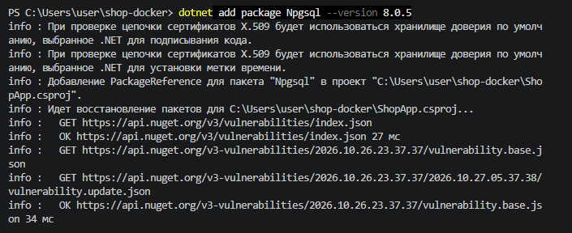
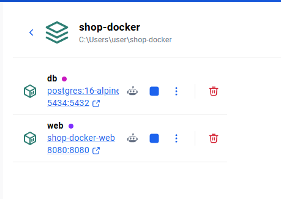
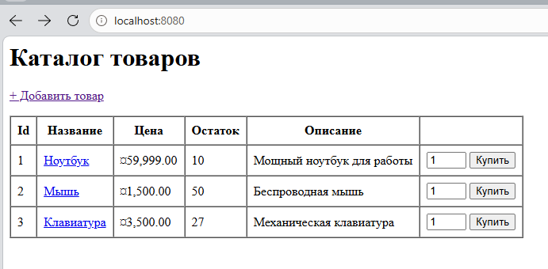
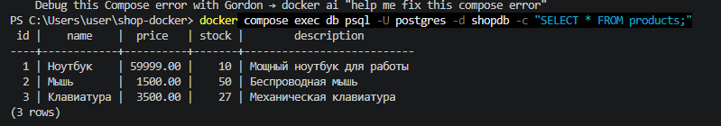
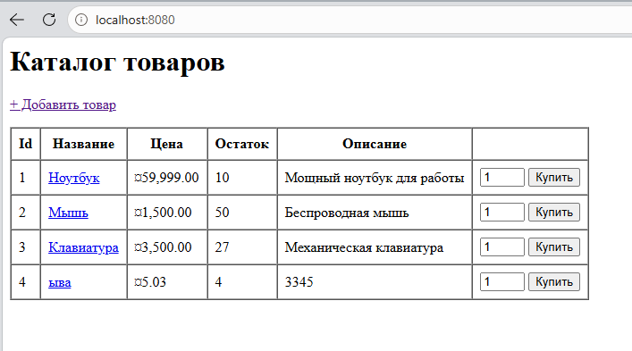
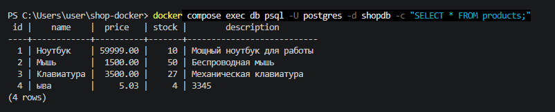
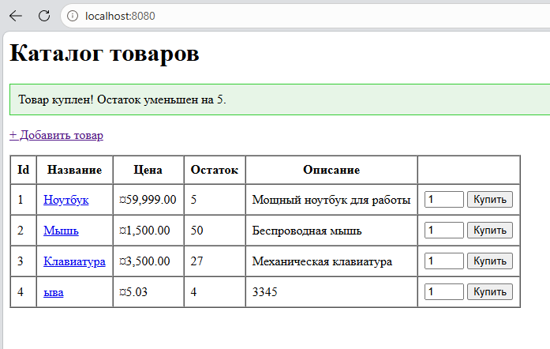
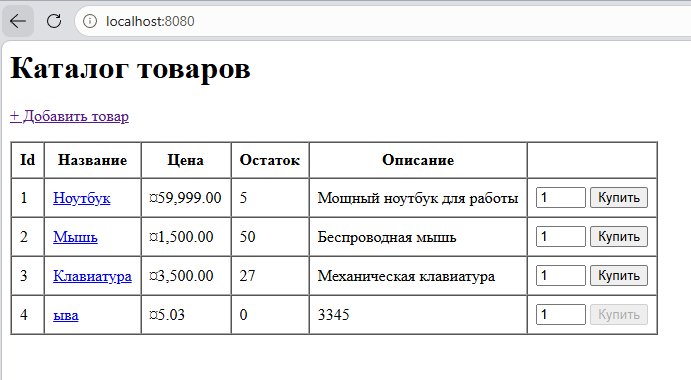
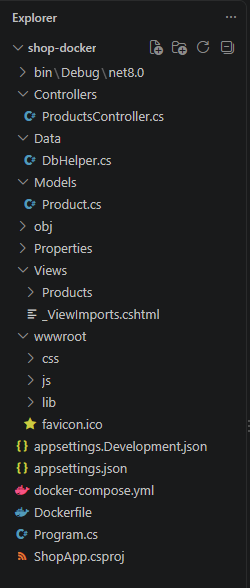

## Создание проекта

### Структура папок

```
shop-docker/
├── docker-compose.yml
├── Dockerfile
├── ShopApp.csproj
├── Program.cs
├── appsettings.json
├── Controllers/
│   └── ProductsController.cs
├── Models/
│   └── Product.cs
├── Data/
│   └── DbHelper.cs
└── Views/
    └── Products/
        ├── Index.cshtml
        ├── Details.cshtml
        ├── Create.cshtml
        └── _ViewImports.cshtml
```

Важно не забыть добавить актуальную для проекта версию Npgsql.



### Создание контейнера

С помощью команды `docker compose up --build ` можно собрать контейнер.

Контейнер в докере:



Сам сайт:



Проверка БД постгрес:



Добавление товара в каталог:





Покупка товара:



Все товары куплены:



Итоговая структура проекта:

