### Задание 1. Поиск запчастей по названию и артикулу

DbHelper:

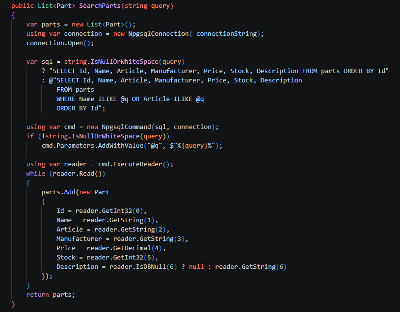

Добавить в Index.cshtml, чтобы можно было искать со стартовой страницы:

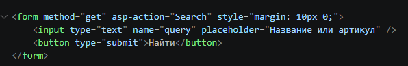

Search.cshtml:

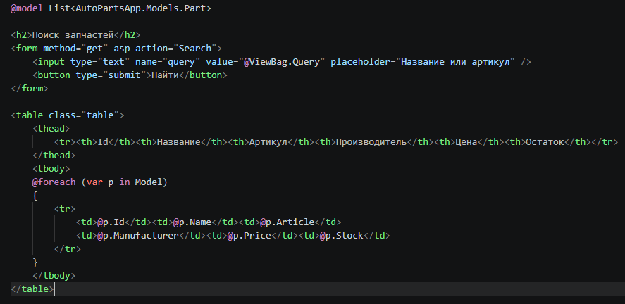

Добавляем к контроллеру (PartsController.cs):

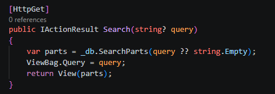

Итог:

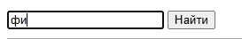

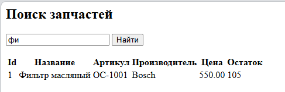

### Задание 2. Удаление запчасти с проверкой результата

DbHelper:

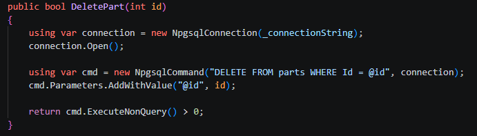

Добавить в Index.cshtml, чтобы можно было удалить со стартовой страницы:

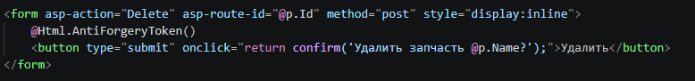

Добавляем к контроллеру (PartsController.cs):

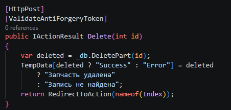

Итог:

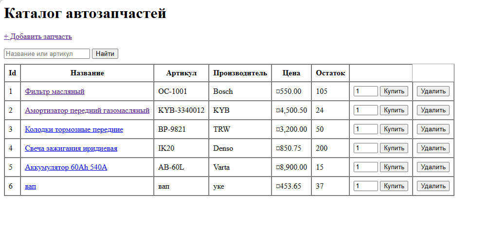

При нажатии:

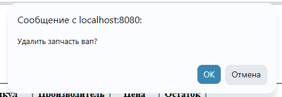

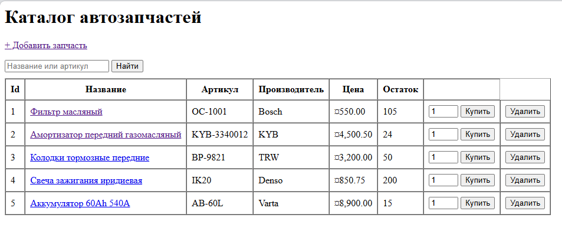

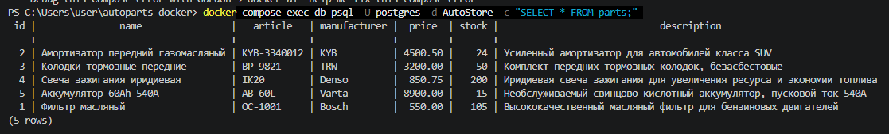

### Задание 3. Статистика по складу одним запросом

DbHelper:

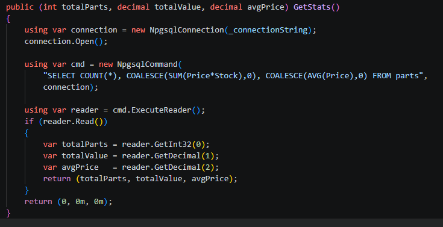

Добавляем к контроллеру (PartsController.cs):

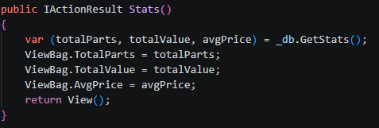

Stats.cshtml:

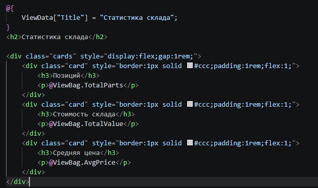

Index.cshtml:

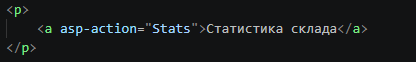

Итог:

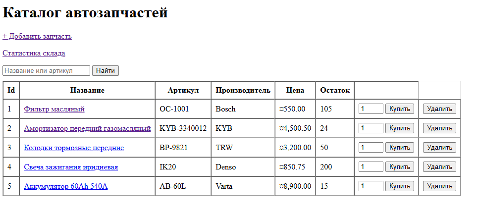

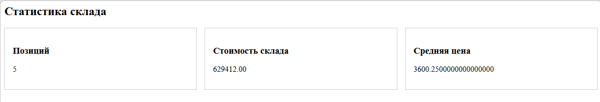

### Задание 4. Оформление заказа в транзакции

Orders:

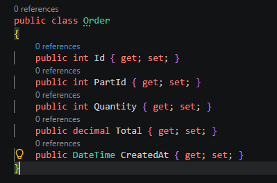

DbHelper (Initialize):

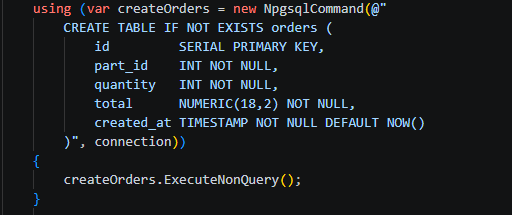

```
 public bool PlaceOrder(int partId, int quantity)
    {
        using var connection = new NpgsqlConnection(_connectionString);
        connection.Open();
        using var tx = connection.BeginTransaction();

        try
        {
            decimal price;
            int stock;

            using (var readCmd = new NpgsqlCommand(
                "SELECT Price, Stock FROM parts WHERE Id = @id", connection, tx))
            {
                readCmd.Parameters.AddWithValue("@id", partId);
                using var reader = readCmd.ExecuteReader();
                if (!reader.Read())
                {
                    tx.Rollback();
                    return false;
                }
                price = reader.GetDecimal(0);
                stock = reader.GetInt32(1);
            }

            if (stock < quantity)
            {
                tx.Rollback();
                return false;
            }

            var total = price * quantity;

            using (var insertCmd = new NpgsqlCommand(@"
                INSERT INTO orders (part_id, quantity, total)
                VALUES (@pid, @qty, @total)", connection, tx))
            {
                insertCmd.Parameters.AddWithValue("@pid", partId);
                insertCmd.Parameters.AddWithValue("@qty", quantity);
                insertCmd.Parameters.AddWithValue("@total", total);
                insertCmd.ExecuteNonQuery();
            }

            using (var updateCmd = new NpgsqlCommand(@"
                UPDATE parts SET Stock = Stock - @qty WHERE Id = @id", connection, tx))
            {
                updateCmd.Parameters.AddWithValue("@qty", quantity);
                updateCmd.Parameters.AddWithValue("@id", partId);
                if (updateCmd.ExecuteNonQuery() == 0)
                {
                    tx.Rollback();
                    return false;
                }
            }

            tx.Commit();
            return true;
        }
        catch
        {
            tx.Rollback();
            throw;
        }
    }
```

тут скрин не влезает так что так вставлю

PartsController:

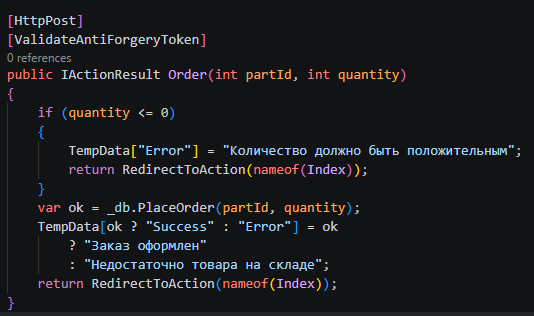

Итог:

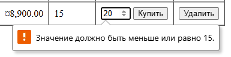

### Задание 5. Массовое поступление товара с откатом при ошибке


### Задание 8. Асинхронная версия GetAllParts

Переписанный метод в DbHelper:

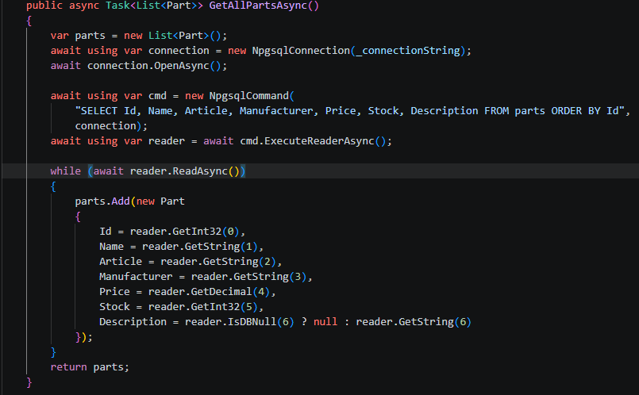

Index:

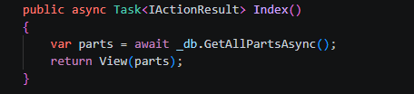


### Задание 9. Обработка уникального ограничения (SqlState)

DbHelper:

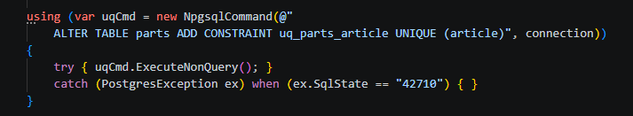

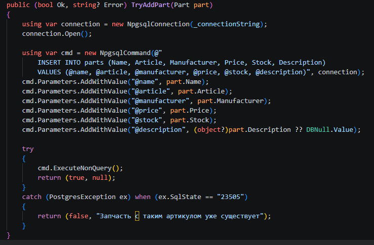

PartsController:

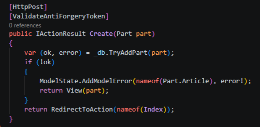

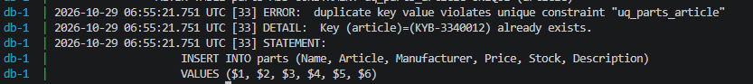

### Задание 10. Пул соединений и Maximum Pool Size

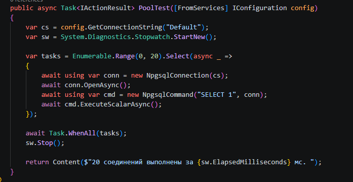

Итог:

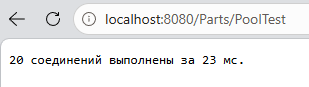

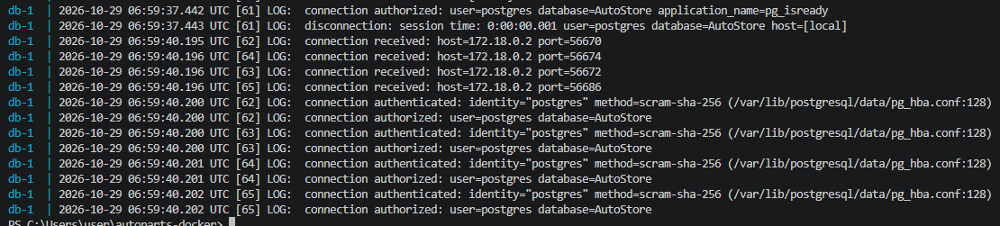

NpgsqlConnection при Dispose() не закрывает соединение с постгрес, а возвращает его в пул соединений. Пул держит до Maximum Pool Size физических соединений и переиспользует их. Поэтому using вокруг NpgsqlConnection - это «взять из пула/вернуть в пул», а не «открыть/закрыть». При Maximum Pool Size=5 20 параллельных запросов создадут не более 5 реальных подключений в постгрес, остальные 15 будут ждать в очереди пула.