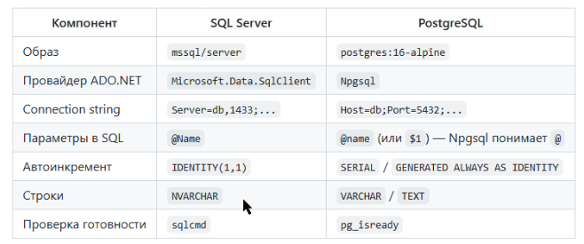
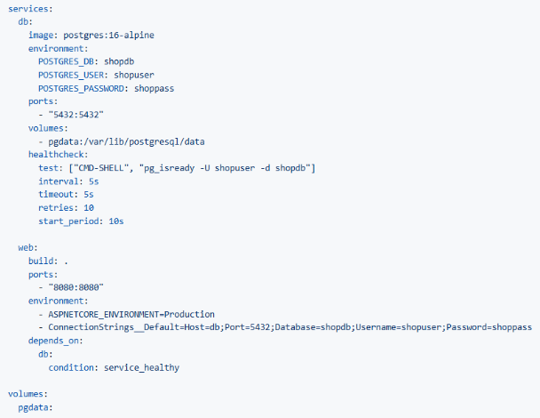
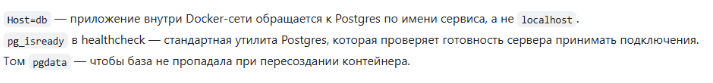
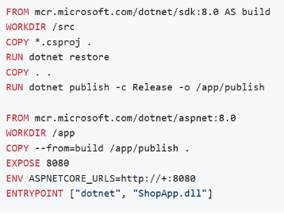
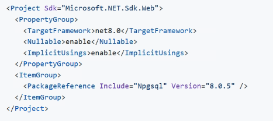
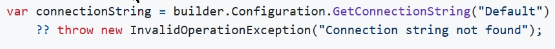

dockerfile - сбор image
docker-compose -сбор контейнера

## docker-compose

Здесь строка подключается прописыается сразу внутри файла, потом нам надо просто к нему обращаться.

## dockerfile

## csproj

executenonquery - выполняет команду которая ничего не возвращает

Принцип чтения и отображения данных БД:
строка в БД -> класс -> список -> отображение на сайте

Достаём подключение из docker-compose

Создаём строителя - вытаскиваем строку подключения - подключаемся к БД (синглтон) - начинаем строить приложение