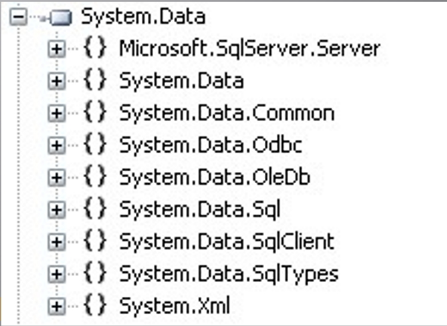
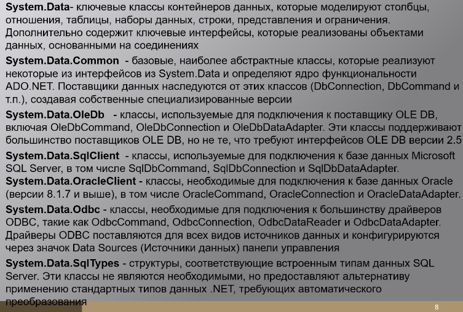
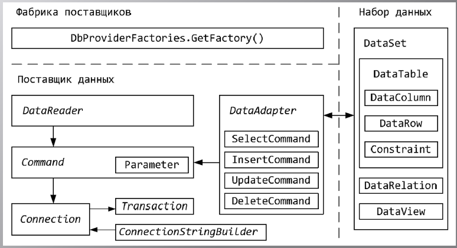
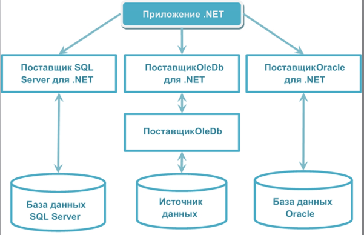
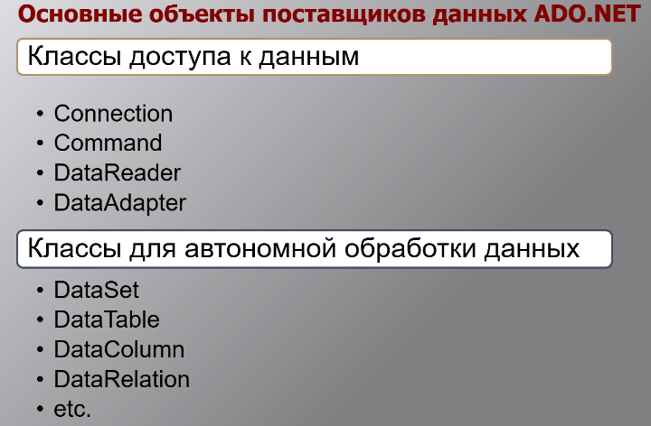
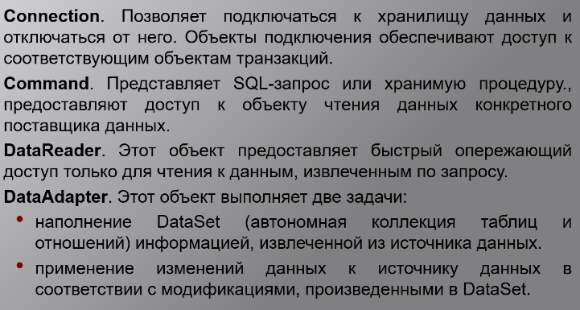
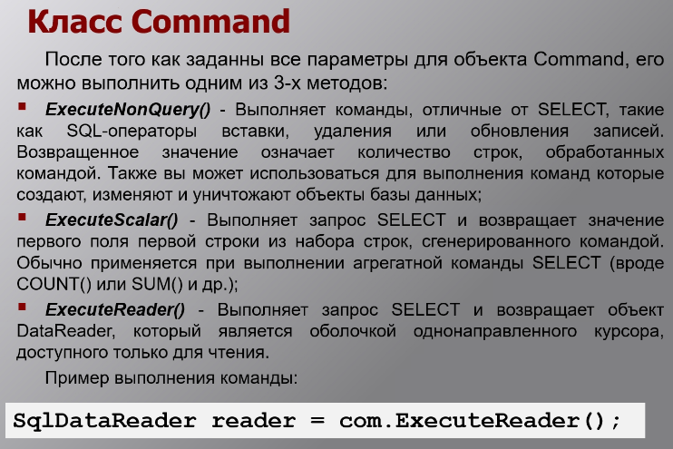

ADO.NET - технология доступа к внещним источникам. Набор классов, предоставляющих служды дсотупа к данным программисту, работающему на платформе .NET Framework.

### Фундаментальные классы ADO.NET

### Архитектура ADO.NET

## Поставщики

### Объекты поставщиков

### Структура поставщиков

## Типы команд

### Класс Command

