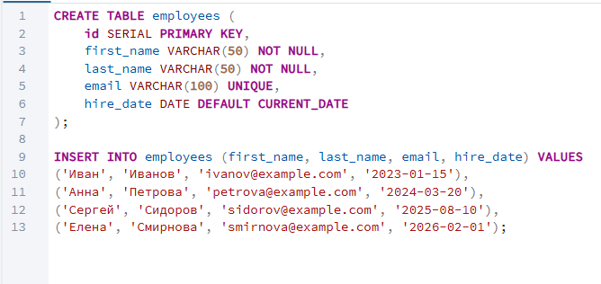
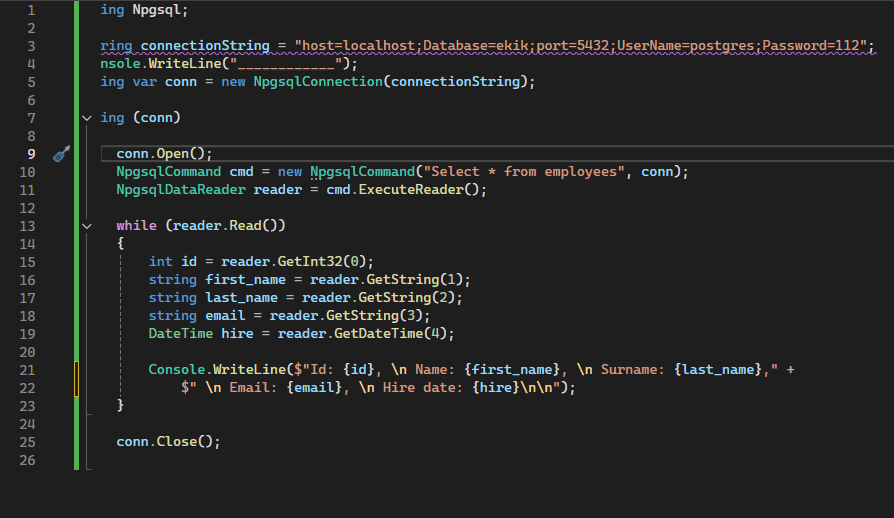
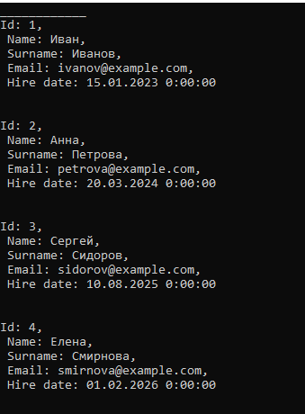
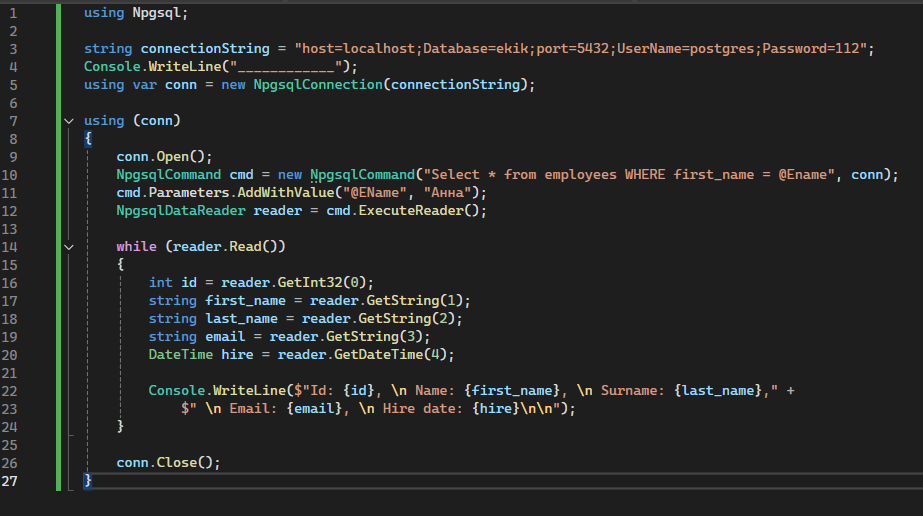

## Создание и заполнение таблиц в PostgeSQL

## Подключение и выполнение запросов из Visual Studio

### Чтение без параметризаторов

Подключаемся к БД и читаем данные из таблицы

### Чтение через параметризатор

