## Подготовка к проекту

### 1. Подготовка VS Code

Необходимо скачать следующие расширения внутри VS Code:

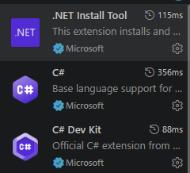

После этого нужно установить SDK:

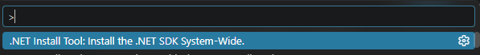

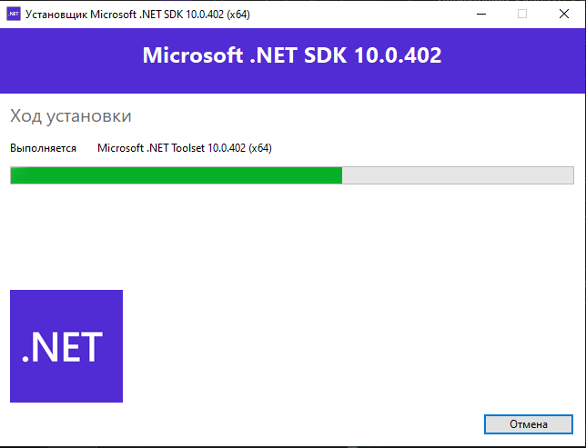

Они необходимы для корректной работы ADO.NET.

### 2. Установка Docker 

1. Скачать загрузчик.

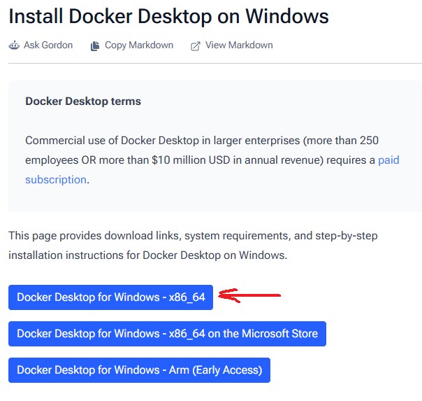

2. В PowerShell запустить команду:

 `wsl --install`

это начнёт скачку подсистемы линукса на винду. WSL необходим для работы докера, т.к контейнерам требуется дро ОС Linux

3. После установки WSL в командной строке написать:

`Docker Desktop Installer.exe" install`

Докер начнёт закачку.

4. Докер установлен

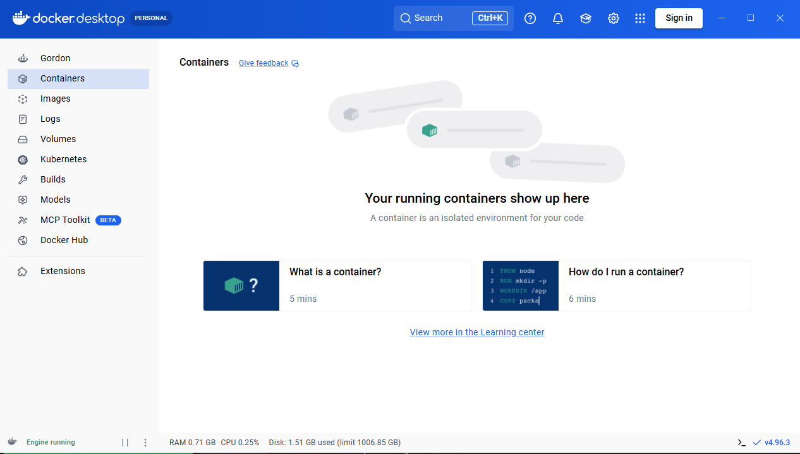

## Создание проекта

### 1. Создание шаблона

1. С помощью команды

`dotnet new mvc -n AutoPartsApp -o autoparts-docker`

можно создать новый проект веб-приложения на базе шаблона ASP.NET Core MVC.

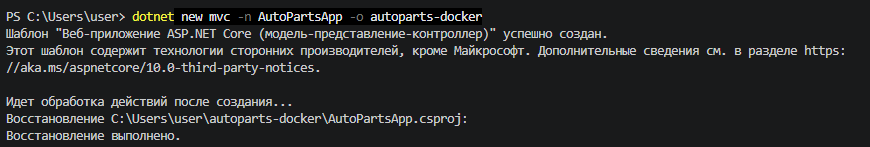

2. Переходим внутрь папки проекта и ставим нужную версию Npgsql

`dotnet add package Npgsql --version 8.0.5`

3. Настраиваем структуру проекта

```
autoparts-docker/
├── Controllers/
│   └── PartsController.cs
├── Data/
│   └── DbHelper.cs
├── Models/
│   └── Parts.cs
├── Properties/
│   └── launchSettings.json
├── Views/
│   ├── Parts/
│   │   ├── Create.cshtml
│   │   ├── Details.cshtml
│   │   └── Index.cshtml
│   └── _ViewImports.cshtml
├── appsettings.json
├── AutoPartsApp.csproj
├── docker-compose.yml
├── Dockerfile
└── Program.cs
```

### 4. Запуск

Внутри корневого каталога с помощью команды

`docker compose up --build`

докер сам собирает контейнер по docker-compose.yml.

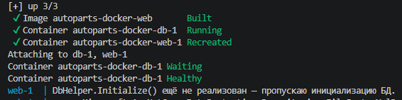
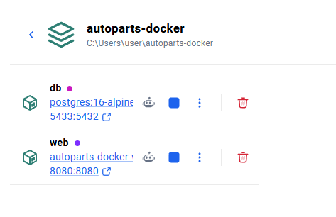

Пока нет заполненного DbHepler, сайт адекватно работать не будет.

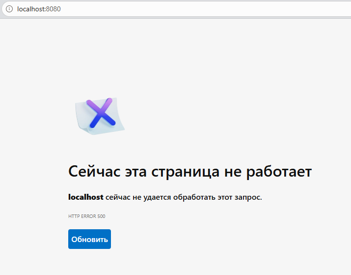

## Заполнение DbHelper

DbHelper - ключевой элемент проекта, который отвечает за связь веб-сайта с БД.

### Подключение к БД

Для подключения к БД необходимо получить строку подключения. Эту строку мы получаем из compose-docker файла.

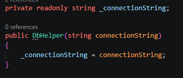

### 1. Инициализация

1. Открываем подключение по строке. Используем using, чтобы программа сама закрыла подключение при завершении функции;
2. Если таблицы нет - создаём её;
3. Проверяем наличие данных в таблице (SELECT). Если их нет - заполняем тестовыми данными.
Тестовые данные заполняла через нейронку потому что я не разбираюсь в машинках.

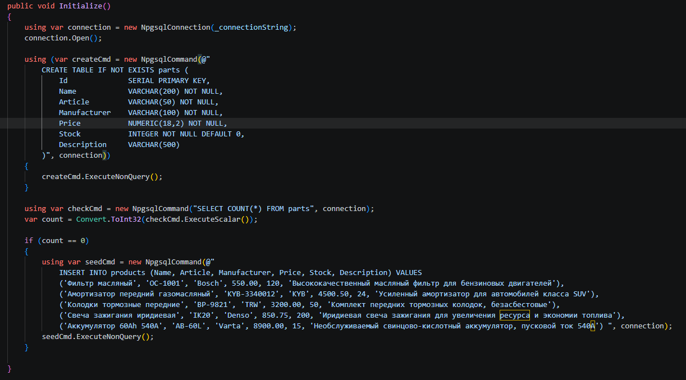

### 2. Получение всех запчастей

1. Открываем подключене;
2. Создаём команду для получения всех запчастей в таблице (SELECT), используем её для создания reader;
3. С помощью reader и ранее созданного списка под запчасти читаем все данные из таблицы и закидываем их в список для удобного вывода

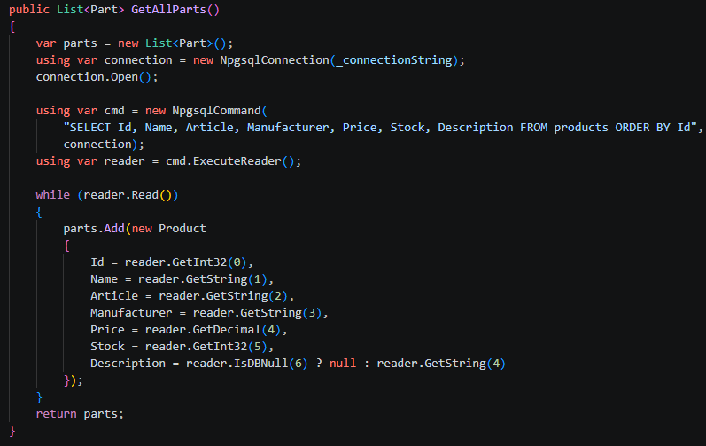

### 3. Получение одной запчасти по ID

1. Открываем подключене;
2. Создаём команду для получения одной запчасти по id (SELECT), добавляем в неё параметизатор через Parameters.AddWithValue. Используем для создания reader;
3. Создаём новый объект Part, получая данные из reader.

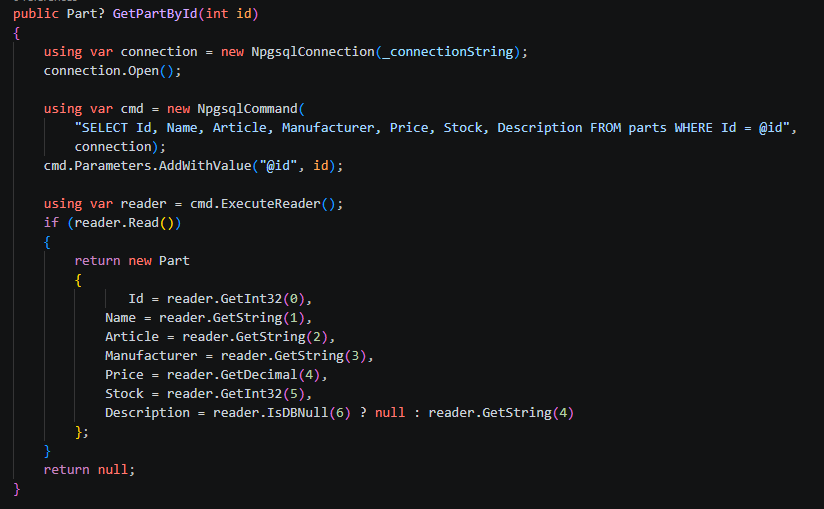

### 4. Вставка новой запчасти в таблицу БД

1. Открываем подключене;
2. Создаём команду для вставки с параметрами (INSERT), добавляем параметизаторы со значениями, полученными из part, который мы передаём в функцию извне;
3. Выполняем через ExecuteNonQuery - т.к нам не надо возвращать никаких данных.

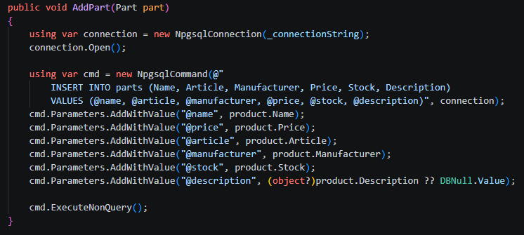

### 5. Уменьшение кол-ва товара

1. Открываем подключене;
2. Создаём команду для обновления таблицы (UPDATE): уменьшение стока у строки, где id совпадает с полученным в функцию id и размер стока больше размера, который мы хотим забрать;
3. Заполняем данные через параметризаторы и выпоняем команду через ExecuteNonQuery.

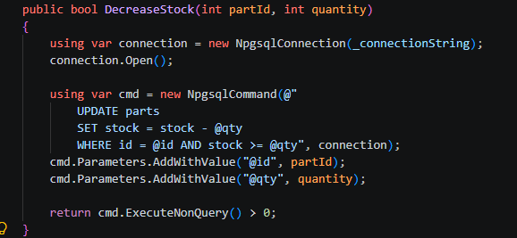

## Полноценный запуск

С помощью команды

`docker compose up -d --build web`

выполняем сборку image без полной пересборки docker-compose.yml.

Итоговая структура проекта:

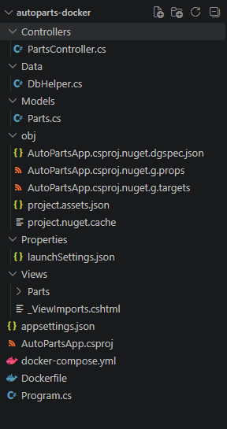

Теперь сайт выглдяит вот так:

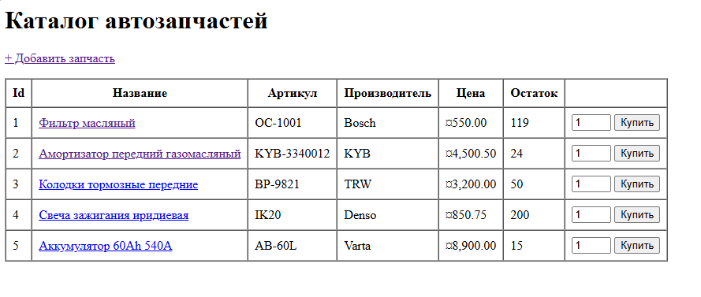

По нажатию "Доавить запчасть" открывается новая страница:

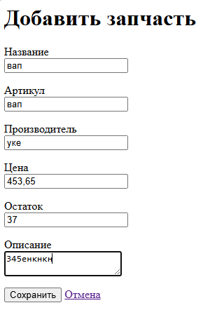

Всё успешно добавляется

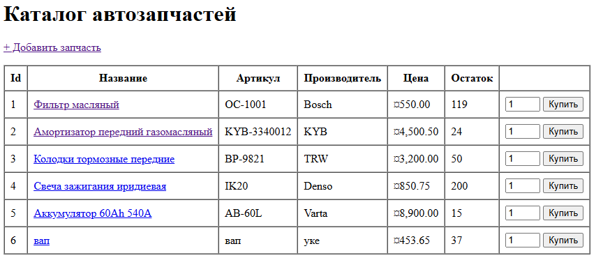

При нажатии на запчасть:

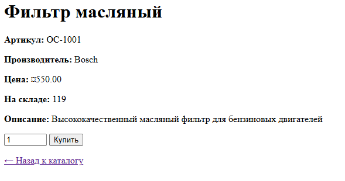

При покупке:

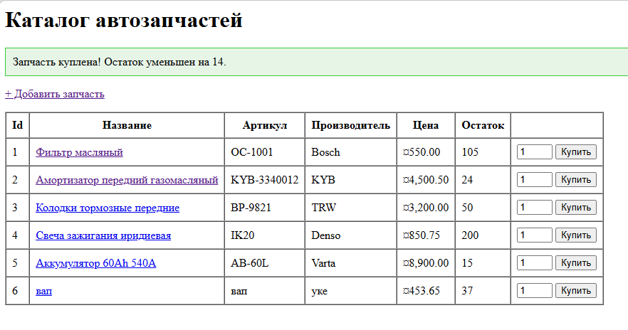