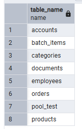
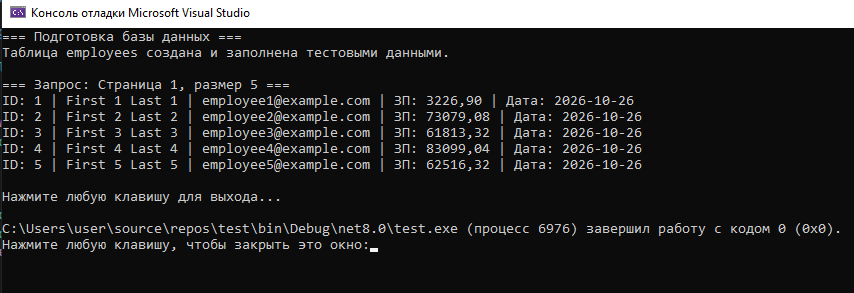
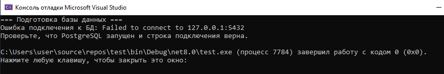
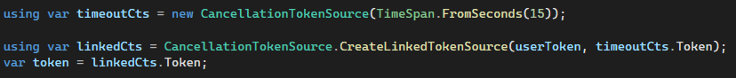
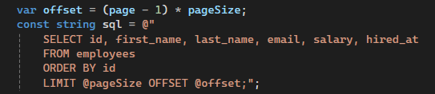
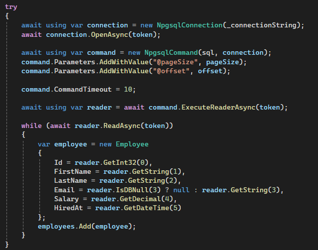
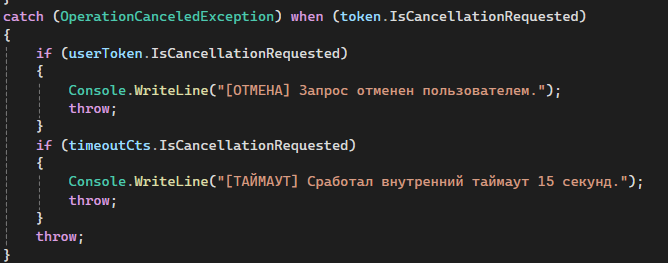
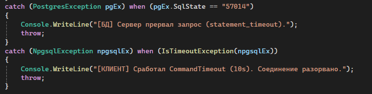
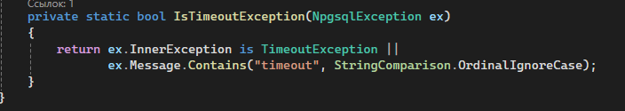

## Создание таблиц



## Задание 1. Базовый асинхронный репозиторий с отменой и таймаутом


```
using System.Data;
using Npgsql;

namespace EmployeeRepoTest
{
    public class Employee
    {
        public int Id { get; set; }
        public string FirstName { get; set; } = string.Empty;
        public string LastName { get; set; } = string.Empty;
        public string? Email { get; set; }
        public decimal Salary { get; set; }
        public DateTime HiredAt { get; set; }
    }

    public class EmployeeRepository
    {
        private readonly string _connectionString;

        public EmployeeRepository(string connectionString)
        {
            _connectionString = connectionString;
        }

        public async Task<List<Employee>> GetEmployeesAsync(int page, int pageSize, CancellationToken userToken)
        {
            var employees = new List<Employee>();

            using var timeoutCts = new CancellationTokenSource(TimeSpan.FromSeconds(15));

            using var linkedCts = CancellationTokenSource.CreateLinkedTokenSource(userToken, timeoutCts.Token);
            var token = linkedCts.Token;

            var offset = (page - 1) * pageSize;
            const string sql = @"
                SELECT id, first_name, last_name, email, salary, hired_at
                FROM employees
                ORDER BY id
                LIMIT @pageSize OFFSET @offset;";

            try
            {
                await using var connection = new NpgsqlConnection(_connectionString);
                await connection.OpenAsync(token);

                await using var command = new NpgsqlCommand(sql, connection);
                command.Parameters.AddWithValue("@pageSize", pageSize);
                command.Parameters.AddWithValue("@offset", offset);

                command.CommandTimeout = 10;

                await using var reader = await command.ExecuteReaderAsync(token);

                while (await reader.ReadAsync(token))
                {
                    var employee = new Employee
                    {
                        Id = reader.GetInt32(0),
                        FirstName = reader.GetString(1),
                        LastName = reader.GetString(2),
                        Email = reader.IsDBNull(3) ? null : reader.GetString(3),
                        Salary = reader.GetDecimal(4),
                        HiredAt = reader.GetDateTime(5)
                    };
                    employees.Add(employee);
                }
            }
            catch (OperationCanceledException) when (token.IsCancellationRequested)
            {
                if (userToken.IsCancellationRequested)
                {
                    Console.WriteLine("[ОТМЕНА] Запрос отменен пользователем.");
                    throw;
                }
                if (timeoutCts.IsCancellationRequested)
                {
                    Console.WriteLine("[ТАЙМАУТ] Сработал внутренний таймаут 15 секунд.");
                    throw;
                }
                throw;
            }
            catch (PostgresException pgEx) when (pgEx.SqlState == "57014")
            {
                Console.WriteLine("[БД] Сервер прервал запрос (statement_timeout).");
                throw;
            }
            catch (NpgsqlException npgsqlEx) when (IsTimeoutException(npgsqlEx))
            {
                Console.WriteLine("[КЛИЕНТ] Сработал CommandTimeout (10s). Соединение разорвано.");
                throw;
            }

            return employees;
        }

        private static bool IsTimeoutException(NpgsqlException ex)
        {
            return ex.InnerException is TimeoutException ||
                   ex.Message.Contains("timeout", StringComparison.OrdinalIgnoreCase);
        }
    }

    internal class Program
    {
        static async Task Main(string[] args)
        {
            string connectionString = "Host=localhost;Port=5432;Database=postgres;Username=postgres;Password=112";

            Console.WriteLine("=== Подготовка базы данных ===");
            try
            {
                await PrepareDatabaseAsync(connectionString);
                Console.WriteLine("Таблица employees создана и заполнена тестовыми данными.\n");
            }
            catch (Exception ex)
            {
                Console.WriteLine($"Ошибка подключения к БД: {ex.Message}");
                Console.WriteLine("Проверьте, что PostgreSQL запущен и строка подключения верна.");
                return;
            }

            var repository = new EmployeeRepository(connectionString);

            Console.WriteLine("=== Запрос: Страница 1, размер 5 ===");
            try
            {
                var employees = await repository.GetEmployeesAsync(1, 5, CancellationToken.None);

                foreach (var emp in employees)
                {
                    Console.WriteLine($"ID: {emp.Id} | {emp.FirstName} {emp.LastName} | {emp.Email} | ЗП: {emp.Salary:F2} | Дата: {emp.HiredAt:yyyy-MM-dd}");
                }
            }
            catch (Exception ex)
            {
                Console.WriteLine($"Ошибка при выполнении запроса: {ex.Message}");
            }

            Console.WriteLine("\nНажмите любую клавишу для выхода...");
            Console.ReadKey();
        }

        static async Task PrepareDatabaseAsync(string connectionString)
        {
            const string sql = @"
                DROP TABLE IF EXISTS employees CASCADE;
                CREATE TABLE employees (
                    id          SERIAL PRIMARY KEY,
                    first_name  VARCHAR(100) NOT NULL,
                    last_name   VARCHAR(100) NOT NULL,
                    email       VARCHAR(255) UNIQUE,
                    salary      NUMERIC(12,2),
                    hired_at    TIMESTAMPTZ DEFAULT now()
                );

                INSERT INTO employees (first_name, last_name, email, salary)
                SELECT 
                    'First ' || i,
                    'Last ' || i,
                    'employee' || i || '@example.com',
                    (random() * 100000)::NUMERIC(12,2)
                FROM generate_series(1, 50) AS i;
            ";

            await using var connection = new NpgsqlConnection(connectionString);
            await connection.OpenAsync();

            await using var command = new NpgsqlCommand(sql, connection);
            await command.ExecuteNonQueryAsync();
        }
    }
}
```

Результат:



Для чистоты эксперимента даже убрала постгрес из диспетчера задач, чтобы выкатилась ошибка:



### Что вообще происходит (я не понимаю)

Пагинация - процесс разбиения большого объема информации (в данном случае - запросов к базе данных) на отдельные, меньшие страницы или блоки.



1. Генерируем токен (`CancellationTokenSource`) - он генерирует сигнал отмены. Здесь - автоматически через 15 секунд.
2. Связываем токен с "наружной" отменой - отменой со стороны пользователя и т.д. Мы связываем все токены в один, чтобы передавать во все методы один токен.



1. offset - смещение для выбора нужной страницы данных. Размер страницы мы устанваливаем сами, номер запрашиваемой страницы - тоже. Страница - это n-ое количество строчек.
2. Дальше с помощью SQL запроса устанавливается лимит страницы (по строкам) и размер оффсета. Всё через параметризаторы.



1. Подключаемся к БД через `await using` - здесь мы обозначаем, что подключение асинкронно.
2. Открываем асинхронное соединение и передаём в него токен для обработки таймаутов.
3. Асинхронная команда с параметризаторами.
5. Устанавливаем собственный таймаут команды в 10 секунд.
6. Команда для асинхронного чтения данных.
7. Читаем данные и переводим в читаемый вид внутри консоли.



1. Обработка прерывания операции через токен. Обрабатывает отмену от пользователя (usetToken), и от самой системы (timeoutCts).



1. Обработка ошибки от постгрес. 57014 - код ошибки: сервер выполнял запрос дольше отведённого времени, и сервер сам его убил, но сохранил соединение.
2. Происходит ошибка со стороны клиента, из-за чего соединение разрывается.



1. Проверяет, что ошибка произошла именно из-за таймаута, а не произошло что-то иное.