# БИЛЕТ 8 - «Аптека: лекарства и продажи»

## Подготовка к проекту

1. Создаём шаблон MVC приложения:

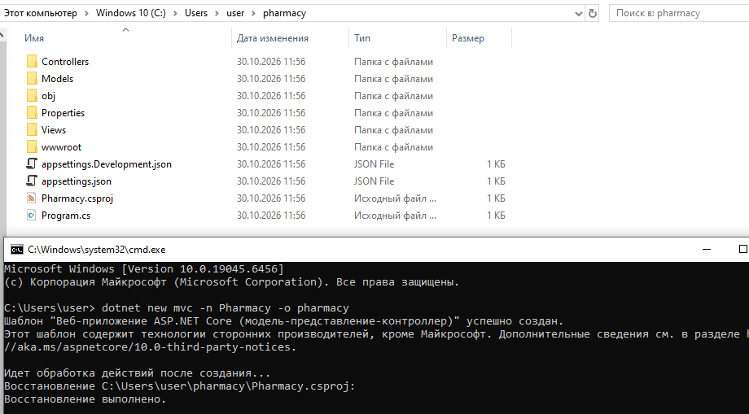

2. Добавить пакет Npgsql для работы: `dotnet add package Npgsql --version 8.0.5`.

3. Добавить Dapper для работы: `dotnet add package Dapper`.

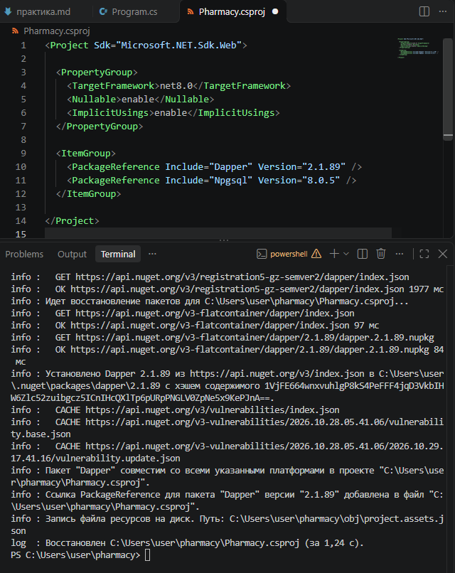


4. Оформить подключение к БД:

`appsettings.json`

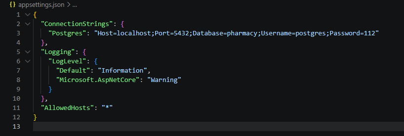

`IDbConnectionFactory.cs`

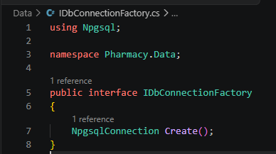

`PostgresConnectionFactory.cs`

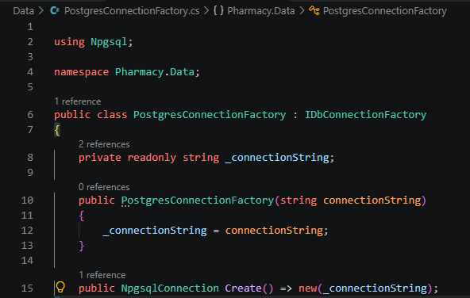


## Проект

1. `Program.cs`

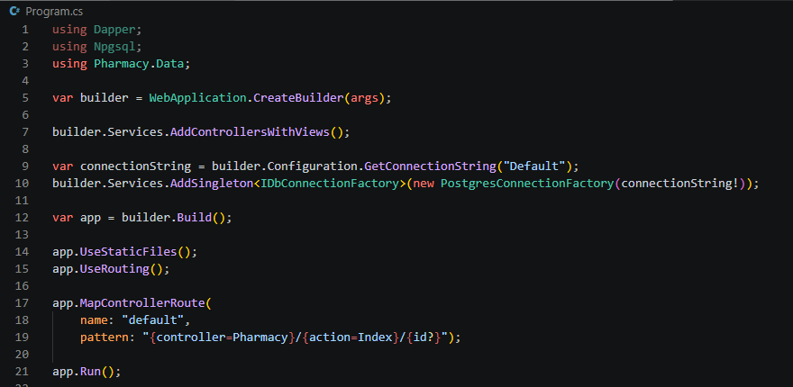

2. `Index.cshtml`

```
@model List<Pharmacy.Models.Med>

@{
    ViewData["Title"] = "Список лекарств";
    var query = ViewBag.Query as string;
}

<h2>Аптека: Лекарства</h2>

@if (TempData["Message"] is string msg)
{
    <div class="alert alert-success">@msg</div>
}

<div class="mb-3">
    <a asp-action="Report" class="btn btn-info text-white">Посмотреть отчет по продажам</a>
</div>

<form method="get" asp-action="Index" class="mb-4">
    <div class="input-group">
        <input type="text" name="q" class="form-control" placeholder="Поиск по названию..." value="@query" />
        <button type="submit" class="btn btn-primary">Найти</button>
        @if (!string.IsNullOrEmpty(query))
        {
            <a asp-action="Index" class="btn btn-outline-secondary">Сбросить</a>
        }
    </div>
</form>

@if (!Model.Any())
{
    <div class="alert alert-warning">Лекарства не найдены.</div>
}
else
{
    <table class="table table-striped table-bordered">
        <thead class="table-dark">
            <tr>
                <th>ID</th>
                <th>Название</th>
                <th>Количество (шт.)</th>
                <th>Цена (руб.)</th>
                <th>Действия</th>
            </tr>
        </thead>
        <tbody>
        @foreach (var med in Model)
        {
            <tr>
                <td>@med.Id</td>
                <td>@med.Name</td>
                <td>@med.Qty</td>
                <td>@med.Price.ToString("F2")</td>
                <td>
                    <a asp-action="Sale" asp-route-medId="@med.Id" class="btn btn-sm btn-success">
                        Продать
                    </a>
                </td>
            </tr>
        }
        </tbody>
    </table>
}
```
3. `Sale.cshtml`

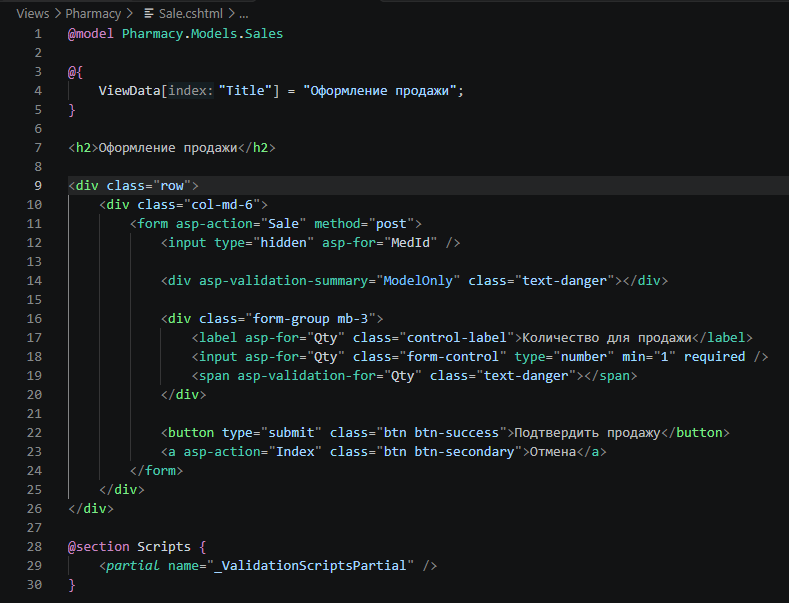

4. `Report.cshtml`

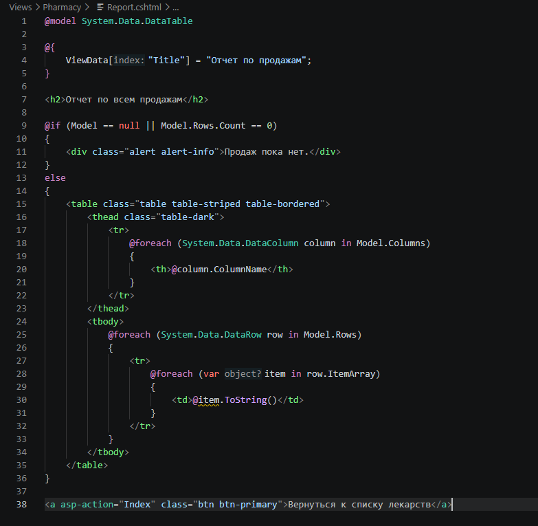

5. `PharmacyController.cs

```
using Microsoft.AspNetCore.Mvc;
using Pharmacy.Models;
using System.Data;
using Pharmacy.Data;
using Dapper;
using Npgsql;

namespace Pharmacy.Controllers;

public class PharmacyController : Controller
{
    private readonly IDbConnectionFactory _dbFactory;

    public PharmacyController(IDbConnectionFactory dbFactory)
    {
        _dbFactory = dbFactory;
    }

    public IActionResult Index(string? q)
    {
        using var connection = _dbFactory.Create();

        string sql = "SELECT id, name, qty, price FROM meds";

        if (!string.IsNullOrEmpty(q))
        {
            sql += " WHERE name ILIKE @SearchTerm";
        }

        sql += " ORDER BY id";

        var meds = connection.Query<Med>(sql, new { SearchTerm = $"%{q}%" }).ToList();

        ViewBag.Query = q;
        return View(meds);
    }

    [HttpGet]
    public IActionResult Sale(int medId)
    {
        return View(new Sales { MedId = medId });
    }

    [HttpPost]
    [ValidateAntiForgeryToken]
    public async Task<IActionResult> Sale(Sales model)
    {
        if (model.Qty <= 0)
        {
            ModelState.AddModelError(nameof(model.Qty), "Количество должно быть больше нуля.");
        }

        if (!ModelState.IsValid)
        {
            return View(model);
        }

        using var connection = _dbFactory.Create();
        await connection.OpenAsync();
        using var transaction = await connection.BeginTransactionAsync();

        try
        {
            var currentQty = await connection.ExecuteScalarAsync<int?>(
                "SELECT qty FROM meds WHERE id = @MedId FOR UPDATE",
                new { model.MedId }, transaction);

            if (currentQty == null)
            {
                await transaction.RollbackAsync();
                ModelState.AddModelError("", $"Лекарство с ID {model.MedId} не найдено.");
                return View(model);
            }

            if (currentQty < model.Qty)
            {
                await transaction.RollbackAsync();
                ModelState.AddModelError("",
                    $"Недостаточно товара. В наличии: {currentQty}, запрошено: {model.Qty}");
                return View(model);
            }

            await connection.ExecuteAsync(
                "INSERT INTO sales (med_id, qty) VALUES (@MedId, @Qty)",
                new { model.MedId, model.Qty }, transaction);

            await connection.ExecuteAsync(
                "UPDATE meds SET qty = qty - @Qty WHERE id = @MedId",
                new { model.MedId, model.Qty }, transaction);

            await transaction.CommitAsync();

            TempData["Message"] = "Продажа успешно оформлена";
            return RedirectToAction(nameof(Index));
        }
        catch (Exception ex)
        {
            await transaction.RollbackAsync();
            ModelState.AddModelError("", $"Ошибка при продаже: {ex.Message}");
            return View(model);
        }
    }

    public IActionResult Report()
    {
        using var connection = _dbFactory.Create();

        string sql = @"
            SELECT 
                s.id AS ""ID продажи"", 
                m.name AS ""Лекарство"", 
                s.qty AS ""Количество"", 
                s.at AS ""Дата""
            FROM sales s
            JOIN meds m ON s.med_id = m.id
            ORDER BY s.at DESC";

        using var adapter = new NpgsqlDataAdapter(sql, connection);
        var dataSet = new DataSet();
        adapter.Fill(dataSet, "ReportData");

        return View(dataSet.Tables["ReportData"]);
    }
}
```

Вынесла реализацию из мейна. По-хорошему бы ещё репозитории отдельные под работу с табличками сделать, но я уже не успеваю :(

Итоговая структура:

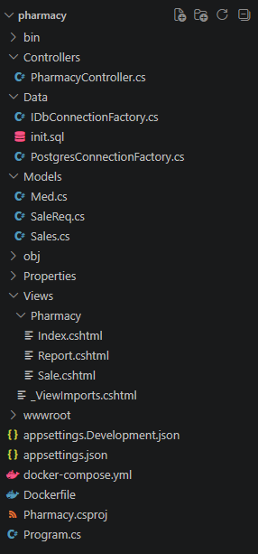

## Результаты

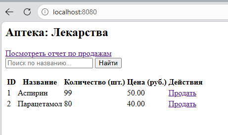

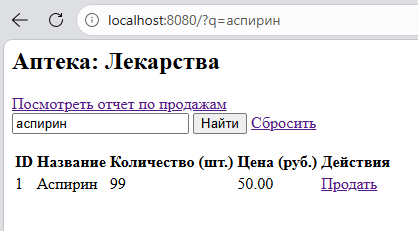

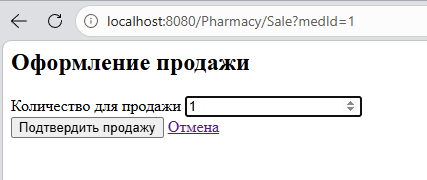

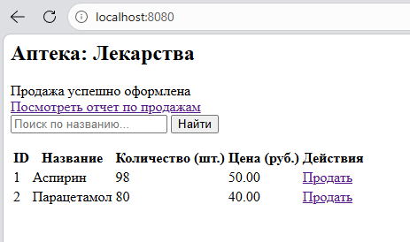

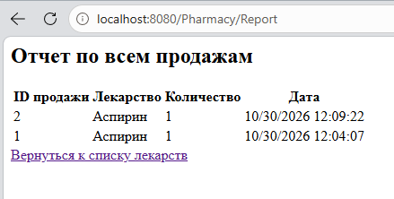


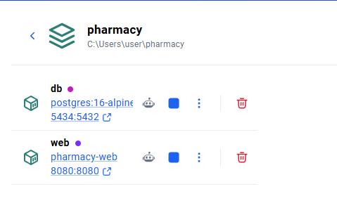